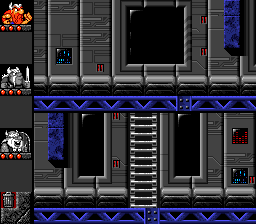

    

    <b>A full split-screen multiplayer modification for a SNES classic.</b>

---

## About The Game

The Lost Vikings is a skill-based puzzle game developed by Silicon & Synapse (later rebranded to Blizzard Entertainment). It originally released on the SNES in 1993, and was later ported to MS-DOS and the Sega Genesis. The gameplay revolves around solving levels by controlling 3 distinct Vikings, each with unique abilities. 

I really enjoyed my solo play-through of this game, and I also enjoy its two-player mode! However, there is a major flaw to the multiplayer mode: **there is no split-screen.**
Player 2 has to remain inside Player 1's camera view. If Player 2 is ever off-screen, they simply can't play, ruining the experience for Player 2.

## The Goal

Simply put, this project aims to give the game's two-player mode vertical split-screen capabilities.

Specifically:
1. Move the Heads-Up Display (HUD) from the top of the screen to the left sidebar.
2. Split the remaining space vertically. 
3. Assign Player 1 to the top viewport and Player 2 to the bottom viewport.

> *It sounds simple on paper, but in SNES reverse engineering, it is a **LOT** easier said than done!*

    

## The Journey & Progress

### 1. Reverse Engineering & Assembly
To start, I dumped my physical cartridge of the game into a ROM file. I then converted it back to SNES assembly code.

> **Dev Note:** *Restrains self from venting about SNES 65c816 operands changing length dynamically depending on 8-bit vs 16-bit register modes, making this **so** much harder and take **so** much longer...*

Once disassembled, the code was: ... still unreadable. It contained autogenerated labels like `LDA.W wram_0042` (Load ram address $42 to accumulator) and `JSR loc_80EC56` (jump to subroutine at 80EC56). Rather than manually naming over 1000 variables and functions by deducing their purposes, I used AI to generate labels, iterating until the parts of the codebase that I needed to understand became readable.

To modify a ROM, we use patches. Inline hooking or trampolining is a common retro modding technique that consists of small jump inserts that replace original code with a jump to a new modded function. I do not like inline hooks because it is quite easy to lose track of how everything works. So instead, I use the entire main code as my patch and make my edits directly to it, making the code significantly cleaner and easier to understand.

### 2. Website
I've been working on this off and on for over a year—*\*looks at the private repository age, then recoils\**. 
However, aside from the legible codebase, I do not have much progress on the actual project. I hope that will change during Hack Club's [Terra event](https://terra.hackclub.com).

To document progress and share updates (and to appease the Terra system), I built a dedicated project site:

👉 **[thaidakar16.github.io/LostMod/](https://thaidakar16.github.io/LostMod/)**

Info on frequent Terra "ships", as well as the patchfiles are available. 
Additionally, if you own a legally obtained ROM dump of *The Lost Vikings*, the website features an in-browser patcher that can apply the assembly modifications and run the game directly in your browser!

---

## Roadmap

Here is the current task list for completing the split-screen mod:

- [x] Compact horizontal screen scrolling
- [x] Modify vertical screen scrolling
- [ ] Implement independent camera tracking for Player 2
- [ ] Adjust object culling behavior for both viewports
- [ ] Redesign and relocate the HUD
- [ ] Reconfigure sprite rendering pipelines
- [ ] Add quality-of-life improvements
- [ ] Implement custom settings 

